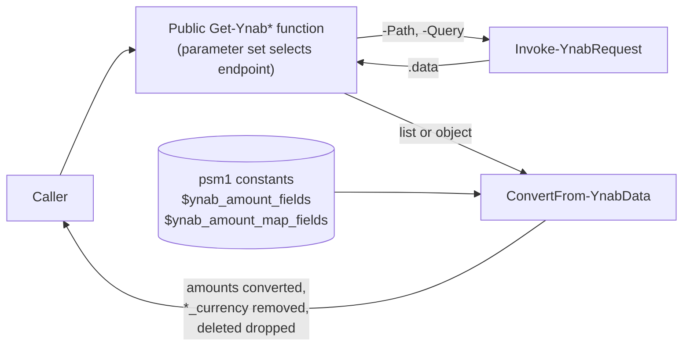

# Core reads: design

Implements [requirements.md](requirements.md). Builds on the [foundation](../foundation/design.md) (`Invoke-YnabRequest`, `ConvertFrom-Milliunit`) and follows the same PowerShell coding standards. Proposes [ADR-0004](#adr-check) for the output-object convention.

## Approach / overview

Each of the seven public functions picks an endpoint from its parameter set, makes one `Invoke-YnabRequest` call, takes the relevant list or object out of the response's `data`, and passes it through one private helper, `ConvertFrom-YnabData`. The helper walks each object and its nested lists: it converts known amount fields from milliunits to `System.Decimal`, removes the `*_currency` copies, and drops items marked `deleted`. The amount-field names live as constants in `PS.YNAB.psm1`. Plan objects gain a `plan_id` property so they can be piped into the other functions without other objects' `id` being mistaken for a plan ID.

## Architecture



### Module constants (`PS.YNAB.psm1`)

Declared before the dot-sourcing loop, so every function can read them:

```text
New-Variable -Name 'ynab_amount_fields' -Option Constant -Value @(
    'activity', 'amount', 'balance', 'budgeted', 'cleared_balance', 'debt_original_balance',
    'goal_overall_funded', 'goal_overall_left', 'goal_target', 'goal_under_funded',
    'income', 'to_be_budgeted', 'uncleared_balance'
)
New-Variable -Name 'ynab_amount_map_fields' -Option Constant -Value @(
    'debt_escrow_amounts', 'debt_interest_rates', 'debt_minimum_payments'
)
```

- `$ynab_amount_fields` lists every int64 amount in the OpenAPI spec. The only other int64 field is `server_knowledge`, which is not an amount; int32 fields such as `age_of_money`, `goal_day` and `goal_percentage_complete` are not amounts either. `debt_original_balance` is deprecated and documented as always null; it is listed so a value would still be converted.
- `$ynab_amount_map_fields` are the account loan fields typed `LoanAccountPeriodicValue`: objects keyed by date whose values are whole numbers. Every value in these maps is converted. That minimum payments and escrow amounts are milliunits is **inferred** from their names; the interest-rate map's unit is **undocumented** (see Risks).

### `ConvertFrom-YnabData` (private)

`[OutputType([System.Management.Automation.PSCustomObject])]`. Takes `-InputObject` from the pipeline (`[System.Object]`, `[AllowNull()]`).

For each input object:

1. If it has `deleted` equal to `$true`, emit nothing (AC-6).
2. For each property:
   - Name in `$ynab_amount_fields` and value is `System.Int64` or `System.Int32`: replace with `ConvertFrom-Milliunit` (AC-4). `$null` stays `$null`.
   - Name is `<amount>_currency` for an `<amount>` in `$ynab_amount_fields`: remove the property (AC-26).
   - Name in `$ynab_amount_map_fields` and value is an object: convert each of its property values the same way.
   - Value is an array: replace it with the array's items passed through `ConvertFrom-YnabData`, so nested lists are converted and filtered too (AC-4, AC-31). The result is always an array, even when it ends up with one item or none.
   - Value is any other object: pass it through `ConvertFrom-YnabData`.
3. Emit the object (AC-5).

It changes the objects `Invoke-RestMethod` produced in place; nothing else holds them. Recursion depth follows the data: the deepest path is a plan's months, then their categories.

### Plan pipeline binding

- `Get-YnabPlanList` and `Get-YnabPlan` add a `plan_id` property, equal to `id`, to each plan object.
- Every plan-scoped function declares `-PlanId` with `ValueFromPipelineByPropertyName` and `[Alias('plan_id')]`, default `'last-used'` (AC-2, AC-3).
- Binding on `plan_id` rather than `id` matters. Accounts, categories, payees and transactions also have an `id`, so an `id` alias would make `Get-YnabAccount | Get-YnabTransaction` send an account ID as the plan ID. Only plan objects carry `plan_id`.
- Each function does its work in `Process`, so piping two plans sends one request per plan.

### `Invoke-YnabRequest` addition

`Get-YnabTransaction` is the first function that needs query parameters. It gains one optional parameter:

| Parameter | Type | Behavior |
|---|---|---|
| `-Query` | `[System.Collections.IDictionary]` | Each entry with a non-null value is appended as `key=value`, URI-escaped with `[System.Uri]::EscapeDataString`, keys in sorted order so the URI is predictable in tests |

The base URI stays fixed (foundation AC-8).

### Per function

All seven are in `Public/`, with `-PlanId` as described above (except `Get-YnabPlanList`, which isn't plan-scoped). Parameter set names follow the skill's leading-underscore convention.

| Function | Parameter sets | Request | Output |
|---|---|---|---|
| `Get-YnabPlanList` | none | `GET /plans` | `data.plans`, each with `plan_id` added. `data.default_plan` is not used |
| `Get-YnabPlan` | none | `GET /plans/{plan_id}` | `data.plan`, one object with `plan_id` added. Its nested lists are converted and filtered |
| `Get-YnabAccount` | `_list` (default); `_id`: `-AccountId` | `/accounts` or `/accounts/{account_id}` | `data.accounts` or `data.account` |
| `Get-YnabCategory` | `_list` (default); `_id`: `-CategoryId` | `/categories` or `/categories/{category_id}` | `_list`: the `category_groups` pass through the helper first (dropping deleted groups), then their `categories` are emitted one per item. Each category already carries `category_group_id` and `category_group_name` (AC-13, AC-27). `_id`: `data.category` |
| `Get-YnabPayee` | `_list` (default); `_id`: `-PayeeId` | `/payees` or `/payees/{payee_id}` | `data.payees` or `data.payee` |
| `Get-YnabMonth` | `_list` (default); `_month`: `-Month` | `/months` or `/months/{month}` | `data.months` or `data.month` |
| `Get-YnabTransaction` | `_plan` (default), `_account`: `-AccountId`, `_category`: `-CategoryId`, each with `-SinceDate`, `-UntilDate`, `-Type`; `_id`: `-TransactionId` | `/transactions`, `/accounts/{id}/transactions`, `/categories/{id}/transactions`, or `/transactions/{id}` | `data.transactions` or `data.transaction` |

Parameter details:

- The ID parameters (`-AccountId`, `-CategoryId`, `-PayeeId`, `-TransactionId`) are `Mandatory` in their set, `[ValidateNotNullOrEmpty()]` `[System.String]`, and are not pipeline-bound.
- Every ID placed in a path, `-PlanId` included, is escaped with `[System.Uri]::EscapeDataString`, so a value containing `/` or `?` cannot change which endpoint is called. (Added while implementing PR 2.)
- `-Month` is `[System.String]`, validated as `current` or a value that converts with `-as [System.DateTime]`, which parses with the invariant culture. A date is sent as the first day of its month, `yyyy-MM-01` (AC-18).
- `-SinceDate` / `-UntilDate` are `[System.DateTime]`, sent as `since_date` / `until_date` in `yyyy-MM-dd` (AC-20, AC-29). If both are given and `-SinceDate` is later than `-UntilDate`, the function raises `YnabInvalidDateRange` (`InvalidArgument`) before sending anything.
- `-Type` is `[ValidateSet('Uncategorized', 'Unapproved')]`, sent lower-cased as `type` (AC-21).
- The four transaction sets make `-AccountId` with `-CategoryId`, and `-TransactionId` with any filter, binding errors (AC-22, AC-24).
- The category transactions endpoint returns YNAB's "hybrid" transactions, where each part of a split is its own row with a `type` and `parent_transaction_id`. The help text says so.

### ADR check

**ADR-0004: Output objects keep YNAB's shape** (proposed with the first PR). It is cross-cutting, since the write functions in step 5 will return the same objects. It records:

- YNAB's property names and casing are kept (AC-25).
- Amounts are converted to `System.Decimal` in place, at any depth (AC-4).
- `*_currency` is dropped and `*_formatted` kept (AC-26).
- Deleted items are dropped (AC-6).
- The one addition is a `plan_id` property on plan objects, for pipeline binding.
- The amount-field lists live as constants in `PS.YNAB.psm1`.

### Coding standards

As in the foundation: `[CmdletBinding()]` with `DefaultParameterSetName` where there are sets, `[OutputType()]`, full .NET type names, a `HelpMessage` on every parameter, a `Begin` block opening with `Write-Verbose`, splatting, single-quoted strings with `-f`, `Write-Error -ErrorAction Stop` instead of `throw`, comment-based help with `.NOTES` `Status: Beta`. No `Clean` block is needed: these functions hold no secrets.

## Affected files / modules

| File | Change | PR |
|---|---|---|
| `docs/specs/core-reads/*.md`, `docs/adr/0004-output-objects-keep-ynab-shape.md` | New | 1 |
| `docs/specs/foundation/tasks.md` | Tick task 6.2 (done after the foundation merge) | 1 |
| `PS.YNAB.psm1` | Add the two constants | 1 |
| `Private/ConvertFrom-YnabData.ps1` + tests | New | 1 |
| `Public/Get-YnabPlanList.ps1` + tests | New | 1 |
| `Public/Get-YnabPlan.ps1` + tests | New | 2 |
| `Public/Get-YnabAccount.ps1` + tests | New | 3 |
| `Public/Get-YnabCategory.ps1` + tests | New | 4 |
| `Public/Get-YnabPayee.ps1` + tests | New | 5 |
| `Public/Get-YnabMonth.ps1` + tests | New | 6 |
| `Private/Invoke-YnabRequest.ps1` + tests | Add `-Query` | 7 |
| `Public/Get-YnabTransaction.ps1` + tests | New | 7 |
| `PS.YNAB.psd1` | Add each function to `FunctionsToExport` | 1–7 |

Each PR references #6; the last closes it. `Get-YnabPlanList` comes first because the others accept its output.

### Tests

- **Public functions mock `Invoke-YnabRequest`**, as AGENTS.md specifies. Mocks return objects built with `ConvertFrom-Json` from JSON shaped like the real `data`, so numbers arrive as the same types `Invoke-RestMethod` produces.
- **Requests:** `Should -Invoke Invoke-YnabRequest -ParameterFilter` checks `-Path` and `-Query`, and that exactly one call was made (AC-1).
- **Parameter sets:** each forbidden combination is asserted to fail with an `AmbiguousParameterSet` or `NamedParameterNotFound` binding error, with zero `Invoke-YnabRequest` calls (AC-24).
- **Pipeline:** a `Get-YnabPlanList`-shaped object piped in binds `-PlanId`; an account-shaped object piped in does not (AC-3).
- **`ConvertFrom-YnabData`:**
  - every listed amount field is converted at the top level and nested inside arrays and objects
  - `*_currency` is removed and `*_formatted` kept
  - loan maps are converted
  - deleted items are dropped from the top level and from nested arrays, and nested arrays stay arrays when one item or none is left
  - `$null` amounts stay `$null`, and non-amount whole numbers (`server_knowledge`, `age_of_money`, `goal_percentage_complete`) are left alone
- **Live checks (you run them):** after the functions exist, an audit snippet runs each one against your plan and prints only property *names*, never values. It lists any remaining `*_currency` property, and any whole-number property not in the amount list. A field YNAB adds later, or one the list missed, shows up there.

## Alternatives considered

| Alternative | Why rejected |
|---|---|
| Detect amounts by their `*_currency` companion | The full plan's transactions, split transactions, months and categories use schemas with no companions (OpenAPI spec), so it would miss them |
| A per-schema field map | More code for the same result, since amount names don't collide across schemas |
| Amount lists inside the helper | Chosen against in review: the psm1 is the module's conventional home for constants, whether or not a second function ever uses them |
| Bind `-PlanId` from the pipeline by `id` | Any YNAB object has an `id`, so piping an account would send its ID as the plan ID |
| Pipeline-bind `-AccountId`, `-CategoryId` and the other IDs | Not required; it would raise the same `id`-ambiguity question for every object type. Can be added later without breaking anyone |
| `-Month` as `[System.DateTime]` plus a `-Current` switch | Two parameters and an extra set to express what the API takes as one string |
| Query parameters appended to `-Path` by each caller | Escaping would be repeated in each caller; one `-Query` parameter does it once |
| Typed output objects (`PSTypeName`) for formatting views | Not needed yet; can be added without changing any property |

## Risks / tradeoffs

- **Name-based conversion:** a future non-amount field that shares a name with an amount field would be wrongly divided by 1000. No current schema has such a collision (OpenAPI spec). Mitigation: the live audit, and listing names explicitly rather than matching patterns.
- **New amount fields stay raw until listed.** YNAB can add a field at any time, and it would pass through as milliunits, breaking AC-4 without any error. Mitigation: the audit snippet, re-run when YNAB announces API changes.
- **The loan interest-rate unit is undocumented.** If `debt_interest_rates` is not in milliunits, dividing by 1000 gives a wrong rate. Mitigation: if you have a loan account, compare one converted rate with the rate YNAB's app shows; if not, it's recorded as unverified in the help text.
- **`Get-YnabPlan` responses can be large,** with every transaction in the plan, and converting them walks every object. This is one request (AC-1), but memory and time grow with plan history. Recorded in its help text; step 3's delta requests are the long-term answer.
- **`plan_id` is the one property we add to YNAB's objects.** ADR-0004 records it so it isn't mistaken for an API field.
- **Hybrid transactions** from the category endpoint differ in shape from the other transaction endpoints. Documented in the help text rather than reshaped, per AC-25.

The well-architected review is skipped. The architecturally significant choice is the output convention, which ADR-0004 records with its consequences; the rest applies the foundation's patterns.
