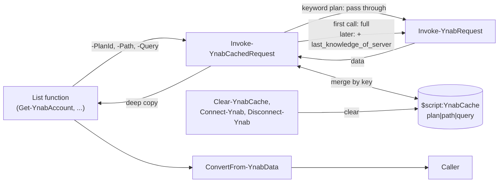

# Delta cache: design

Implements [requirements.md](requirements.md). Proposes [ADR-0005](#adr-check), which also amends ADR-0004.

## Approach / overview

A new private function, `Invoke-YnabCachedRequest`, sits between the list functions and `Invoke-YnabRequest`. For a call with an explicit plan ID it keeps one entry per plan, path and query in a module hashtable: the first call stores the full response's `data`; later calls send `last_knowledge_of_server`, merge the changes into the entry by item key, and store the new `server_knowledge`. It returns a deep copy of the entry, so the calling function's `ConvertFrom-YnabData` and the caller can change the result without touching the cache. Calls with `last-used` or `default` bypass the cache.

## Architecture

### Cache store

- `$script:YnabCache`, a hashtable initialized in `PS.YNAB.psm1`. Each entry is `@{ PlanId; ServerKnowledge; Data }`, keyed `'{0}|{1}' -f $Path, $queryString`. `$Path` already contains the plan ID; `$queryString` is the request's own query, sorted the same way `Invoke-YnabRequest` builds it, without `last_knowledge_of_server` (AC-8).
- In memory only; nothing is written to disk (AC-12).

### Why keyword plans are not cached

YNAB's list responses carry only the list and `server_knowledge`, with no plan ID (OpenAPI spec). If `last-used` began to mean another plan mid-session, for example after the user opens another plan in YNAB's app, a delta request would merge plan B's changes into plan A's entry with no error. So `Invoke-YnabCachedRequest` caches only when `-PlanId` is a UUID; `last-used` and `default` calls go straight to `Invoke-YnabRequest`, downloading the full list as today (AC-8). The other options weighed are under [Alternatives considered](#alternatives-considered).

The cost is bounded: a delta request is still one request, so a bypassed call spends no extra rate-limit budget; it downloads the full list instead of the changes, which matters mainly for `Get-YnabPlan` and long transaction lists. Help for each cached function says so and points to setting a plan ID in `$PSDefaultParameterValues`, which the README already describes.

### `Invoke-YnabCachedRequest` (private)

Parameters: `-PlanId`, `-Path`, `-Query` (as `Invoke-YnabRequest`). Returns the `data` object.

1. If `-PlanId` is not a UUID, write a verbose message (`Not cached: -PlanId is [last-used]. Set a plan ID, for example with $PSDefaultParameterValues['*-Ynab*:PlanId'], to cache this call.`) and return `Invoke-YnabRequest -Path $Path -Query $Query`.
2. Look up the entry. With none, call `Invoke-YnabRequest` without knowledge and store `@{ PlanId; ServerKnowledge = $data.server_knowledge; Data = $data }` (AC-3).
3. With an entry, call `Invoke-YnabRequest` with `last_knowledge_of_server` added to a copy of the query, merge the response into `Data` (below), and store the new `server_knowledge` (AC-4).
4. Any error from `Invoke-YnabRequest` propagates before the entry is touched (AC-10).
5. Return a deep copy: `ConvertTo-Json -Depth 100 -Compress` then `ConvertFrom-Json` (AC-9). Tested: this keeps `DateTime` values and their UTC kind, `Int64` amounts and `Object[]` lists, so `ConvertFrom-YnabData` sees the same types as from `Invoke-RestMethod`. `PSSerializer` was rejected because it turns lists into `ArrayList`, which `ConvertFrom-YnabData` does not treat as a list.

### Merging

`Merge-YnabDelta` (private) merges a delta object into the cached object, property by property:

| Delta property | Cached property | Result |
|---|---|---|
| A list of objects that have a key | A list | Merged by key: a delta item marked `deleted` removes the cached item; an item with a known key is merged into it recursively; an unknown key is appended. Order of existing items is kept |
| An object | An object | Merged recursively (the plan object in `Get-YnabPlan`) |
| Anything else | Anything | Replaced |

- **Key:** `id`, or `month` for month objects, which have no `id`. A list whose items have neither is replaced whole.
- Recursion means a category group that arrives with only its changed categories keeps the rest, and a month or transaction that arrives whole simply overwrites; the merge does not depend on which shape YNAB uses. Both shapes are undocumented (requirements, "Unverified").
- `server_knowledge` is read from the response, not merged.
- Removed items leave the entry (AC-5). `ConvertFrom-YnabData` still drops anything marked `deleted` on output, so a deleted nested item YNAB sends without its parent's removal never reaches the caller.

### Changes to existing functions

| Function | Change |
|---|---|
| `Get-YnabPlan` | Calls `Invoke-YnabCachedRequest` |
| `Get-YnabAccount`, `Get-YnabCategory`, `Get-YnabPayee`, `Get-YnabMonth` | The list branch calls `Invoke-YnabCachedRequest`; the single-item branch is unchanged (AC-1, AC-2) |
| `Get-YnabTransaction` | The `_plan`, `_account` and `_category` sets call `Invoke-YnabCachedRequest`; `_id` is unchanged |
| `Connect-Ynab` | Clears the cache after a token is accepted (AC-13) |
| `Disconnect-Ynab` | Clears the cache (AC-13) |
| `Get-YnabPlanList` | Unchanged (AC-2) |

Each cached function's help gains one paragraph: results are cached for the session when `-PlanId` is a plan ID, every call still asks YNAB for changes, and `Clear-YnabCache` forces a full download (AC-15).

### `Clear-YnabCache` (public)

- No parameters: empties the cache. `-PlanId`: removes that plan's entries; validated as a UUID only, since keyword plans are never cached.
- Writes nothing to the output. Like `Disconnect-Ynab`, no `SupportsShouldProcess`: it changes only in-memory state, and the next call re-downloads.

### Documentation

- `docs/design.md` rule 6 is rewritten to describe the cache and link ADR-0005.
- ADR-0004's status gains an amendment note for its `-IncludeDeleted` sentence.

## Affected files / modules

| File | Change | PR |
|---|---|---|
| `docs/specs/delta-cache/*.md`, `docs/adr/0005-session-only-delta-cache.md`, ADR-0004 amendment note | New / note | 1 |
| `PS.YNAB.psm1` | Initialize `$script:YnabCache` | 1 |
| `Private/Invoke-YnabCachedRequest.ps1`, `Private/Merge-YnabDelta.ps1` + tests | New | 1 |
| `Public/Clear-YnabCache.ps1` + tests, `PS.YNAB.psd1` export | New | 1 |
| `Private/ConvertTo-YnabQueryString.ps1` + tests; `Invoke-YnabRequest` uses it | New, extracted (added while implementing): the cache key and the request URI must build the query string identically, so both call one function instead of keeping two copies | 1 |
| `Public/Connect-Ynab.ps1`, `Public/Disconnect-Ynab.ps1` + tests | Clear the cache | 1 |
| The six list functions + tests | Use the cache; help paragraph | 2 |
| `docs/design.md` | Rule 6 | 2 |
| `.github/workflows/ci.yml` | Re-derive `min-tests` | 1, 2 |

Two PRs for one cross-cutting concern: PR 1 adds the machinery with nothing using it yet, so PR 2's diff is the behavior change alone.

### Tests

- `Merge-YnabDelta`: replace, append, remove on `deleted`, key by `month`, keyless list replaced, recursion into a group with partial categories, order kept, scalar properties replaced.
- `Invoke-YnabCachedRequest`, mocking `Invoke-YnabRequest`: first call full; second sends `last_knowledge_of_server` and merges; keyword plan bypasses, stores nothing and writes the verbose message; different query or plan gets a separate entry; error leaves the entry unchanged; editing the returned object leaves the cache unchanged; `last_knowledge_of_server` is not part of the key.
- Public functions: each test file clears the cache in `BeforeEach`, so tests stay independent. One test per cached function shows a second call with a plan ID sends `last_knowledge_of_server`.
- **AC-6 equivalence:** a test feeds a full response and then a delta to the cached path, and compares the output with an uncached call given the merged-by-hand full response, as JSON.

### Live checks (you run them, in PR 2)

A snippet that, for each cached function with your plan's ID, makes two calls through the cache, then clears it and makes a full call, and prints only `True`/`False` for "cached result equals full result" per function, plus whether the second call sent knowledge. It also settles the two unverified points by printing, as counts only, how many items each delta response carried.

## Alternatives considered

| Alternative | Why rejected |
|---|---|
| Cache keyword plans too, accepting the risk | Silent wrong data if `last-used` changes mid-session, since list responses don't name the plan. Slower but correct is the better failure for a module whose first consumer is a spending alerter |
| Resolve `last-used` to an ID first | The only response that names the plan is the full plan export, the most expensive call there is |
| Resolve `default` from `default_plan` in `GET /plans` | Costs a request, and helps only `default`, not `last-used` |
| Cache keywords when the token has exactly one plan | Costs a request to count plans, and still fails silently if a second plan is created and opened mid-session |
| Detect a mismatch from `server_knowledge` | Each plan has its own counter, so the numbers cannot reliably show which plan answered |
| Replace a changed item whole instead of merging recursively | Would drop unchanged categories if YNAB sends a group with only its changed categories |
| Store the entry as JSON text | Two conversions per call instead of one, for the same isolation |
| `PSSerializer` deep copy | Turns lists into `ArrayList` (tested) |
| Return cached objects directly | A caller's change would alter the cache (AC-9) |
| Persist to disk | Decided against in #21; data at rest, file locations per OS, concurrent writers |

## Risks / tradeoffs

- **The default `last-used` gets no caching.** Users benefit only after setting a plan ID default. Accepted for correctness; documented in help, and each bypassed call says why in its verbose output.
- **Memory.** A cached `Get-YnabPlan` holds the plan's whole history for the session. `Clear-YnabCache` frees it.
- **Copy cost.** Every cached call deep-copies its entry, which for a large plan costs time comparable to parsing the response. To be measured on your plan in the live check; if it is slow, a later change can copy only the items returned.
- **Merge relies on YNAB marking removals.** An item removed without a `deleted` flag in a delta would linger. YNAB's spec says deleted items of every type are included in delta responses, and the live check compares cached with full results.
- **Unverified delta shapes** (filters with transactions; category groups) are handled by the recursive merge either way, and checked live.

## ADR check

**ADR-0005: Session-only delta cache**, proposed with PR 1. Durable and cross-cutting: it sets that the module never writes YNAB data to disk, that only explicit plan IDs are cached, and that every call still asks YNAB for changes. It **amends ADR-0004**, whose Decision says a switch to include deleted items "arrives with delta requests in step 3"; that switch is deferred (requirements, resolved questions).
