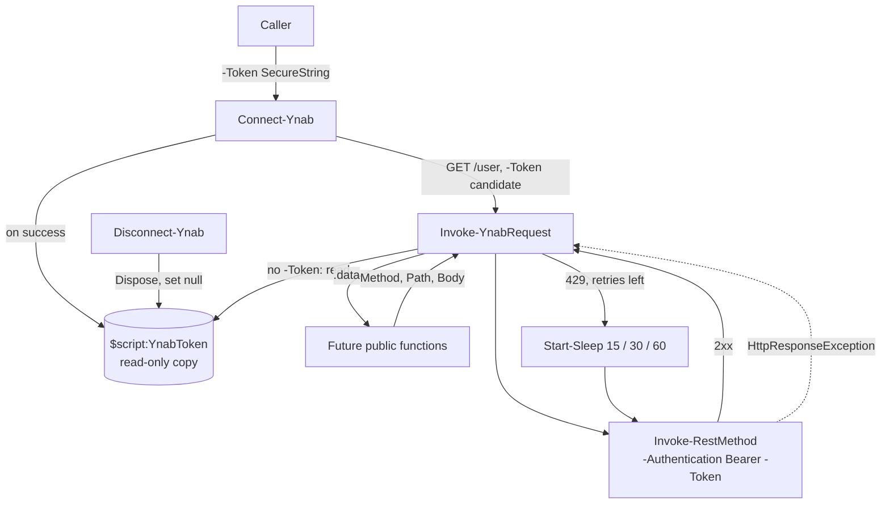

# Foundation: design

Implements [requirements.md](requirements.md). The architecturally significant choices were made in [ADR-0002](../../adr/0002-follow-the-plans-naming.md) and [ADR-0003](../../adr/0003-session-token-auth-and-default-plan.md); this design only carries them out.

## Approach / overview

`Connect-Ynab` validates a caller-supplied `SecureString` with `GET /user` and keeps a private, read-only copy in one script-scope variable. `Invoke-YnabRequest` is the only HTTP caller: it sends to the hardcoded base URI with `Invoke-RestMethod -Authentication Bearer -Token`, catches only `HttpResponseException`, reads the status code and YNAB's error JSON from it, retries 429s on a fixed 15/30/60-second schedule, and raises everything else with `Write-Error -ErrorAction Stop`. Two pure helpers convert between milliunits and `System.Decimal`.

## Architecture



### Session state

- One variable, `$script:YnabToken`, initialized to `$null` in `PS.YNAB.psm1`. Script scope is justified under the PowerShell standards' scope rule: the session must persist across function calls.
- `Connect-Ynab` stores `$Token.Copy()` marked `MakeReadOnly()`, not the caller's object, so `Disconnect-Ynab` can dispose its own copy without disposing a `SecureString` the caller still holds.

### `Connect-Ynab`

```text
[OutputType([System.Void])]
param([Parameter(Mandatory, HelpMessage = ...)] [System.Security.SecureString] $Token)
Begin   { Write-Verbose Starting }
Process {
    $candidate = $Token.Copy(); $candidate.MakeReadOnly()
    try   { $null = Invoke-YnabRequest -Path '/user' -Token $candidate }
    catch { $candidate.Dispose(); Write-Error -ErrorRecord $PSItem -ErrorAction Stop }   # AC-2
    $previous = $script:YnabToken; $script:YnabToken = $candidate
    if ($previous) { $previous.Dispose() }                                               # AC-4
}
Clean   { Remove-Variable -Name 'candidate', 'previous' -Force -ErrorAction Ignore }
```

- The `catch` earns its place by **cleaning up** (disposing the rejected token). It re-raises with `-ErrorRecord $PSItem`, which keeps the original record, as the standards prefer for module functions.
- Nothing is written to the success stream (AC-1).
- `-Token` is `Mandatory`, so `Connect-Ynab` run with no arguments prompts for the token. That PowerShell masks the prompt input for a `SecureString` parameter is **unverified**; it will be checked by hand during implementation.

### `Disconnect-Ynab`

- If `$script:YnabToken` is not `$null`: `Dispose()` it and set it to `$null`. Otherwise do nothing (AC-6, AC-7).
- `[OutputType([System.Void])]`.

### `Invoke-YnabRequest` (private)

`[OutputType([System.Management.Automation.PSCustomObject])]`. Parameters, each with a `HelpMessage`:

| Parameter | Attributes and type | Notes |
|---|---|---|
| `-Method` | `[ValidateSet('Get','Post','Put','Patch','Delete')]` `[System.String]` | Default `'Get'` |
| `-Path` | `Mandatory`, `[ValidatePattern('^/')]` `[System.String]` | Appended to `https://api.ynab.com/v1` |
| `-Body` | `[System.Object]` | When bound: `ConvertTo-Json -Depth 10 -Compress`, `ContentType = 'application/json'` (AC-12) |
| `-Token` | `[System.Security.SecureString]` | Private override used only by `Connect-Ynab` before a session exists. Not the per-function `-Token` that ADR-0003 rejected: no public function has it |

Flow:

1. Use `-Token` if bound, else `$script:YnabToken`. If neither exists: `Write-Error -Message 'Not connected to YNAB. Run Connect-Ynab first.' -ErrorId 'YnabNotConnected' -Category ConnectionError -ErrorAction Stop`. No HTTP call is made (AC-10).
2. Build `$restParams`: `Uri = 'https://api.ynab.com/v1{0}' -f $Path`, `Method`, `Authentication = 'Bearer'`, `Token`, `ErrorAction = 'Stop'`, plus `Body` and `ContentType` when bound (AC-8, AC-9, AC-12).
3. Loop until a response arrives:
   - `try { $response = Invoke-RestMethod @restParams }`
   - `catch [Microsoft.PowerShell.Commands.HttpResponseException]`: read `[System.Int32] $PSItem.Exception.Response.StatusCode`.
     - If the status is 429 and fewer than 3 retries have run, `Write-Verbose` the wait, `Start-Sleep -Seconds` 15, 30 or 60, and loop again (AC-15). This catch **changes control flow**.
     - Otherwise raise the error record below. This catch **adds context**.
   - Any other exception, such as a DNS or TLS failure with no HTTP response, is not caught and surfaces unchanged.
4. After the loop, emit `$response.data` (AC-11). Data is emitted implicitly, never with `return`.

Error record, raised with `Write-Error ... -ErrorAction Stop` (AC-13, AC-14, AC-16):

| `Write-Error` parameter | Value |
|---|---|
| `-Message` | `'YNAB API error {0} {1} ({2}): {3}'` with status, `error.name`, `error.id`, `error.detail`. When the body is not YNAB's shape (JSON parse fails or has no `error`): `'YNAB API returned HTTP {0}'`. A 401 adds: `The token may be invalid or revoked. Run Connect-Ynab again.` |
| `-Exception` | The original `HttpResponseException`. It stays as `$_.Exception`, so callers can still read its type and `Response.StatusCode` (tested) |
| `-ErrorId` | `'YnabApi.{0}' -f error.name`, or `'YnabApi.Http{0}' -f status`. PowerShell appends `,Invoke-YnabRequest` to the `FullyQualifiedErrorId` |
| `-Category` | 401 → `AuthenticationError`, 403 → `PermissionDenied`, 404 → `ObjectNotFound`, 429 → `LimitsExceeded`, anything else → `InvalidOperation` |
| `-TargetObject` | `'{0} {1}' -f $Method, $Path`, never the token |

- Tested: `Write-Error -ErrorAction Stop` inside `Invoke-YnabRequest` stops the public function that called it. That function does not wrap the call; a `catch` that only re-emits is ruled out by the standards.
- Because `-Exception` is the original exception, `$_.Exception.Message` is .NET's text, and the YNAB message is in `$_.ErrorDetails.Message` / `$_.ToString()`. That is also what the console shows.

### Milliunit helpers (private)

- `ConvertFrom-Milliunit`: `[OutputType([System.Decimal])]`, takes `-Milliunit` as `[System.Int64]` from the pipeline, and emits `[System.Decimal] $Milliunit / 1000` (AC-19, AC-22).
- `ConvertTo-Milliunit`: `[OutputType([System.Int64])]`, takes `-Amount` as `[System.Decimal]` from the pipeline, and computes `$milliunit = $Amount * 1000`. If that is not a whole number, it raises `Write-Error -Message ('Amount [{0}] has more than three decimal places' -f $Amount) -ErrorId 'YnabAmountPrecision' -Category InvalidArgument -ErrorAction Stop` (AC-21). Otherwise it emits `[System.Int64] $milliunit` (AC-20).
- `System.Decimal` throughout, so values with up to three decimal places round-trip exactly (AC-23).

### Coding standards applied

The PowerShell skill's advanced-function standards apply to every new function:

- `[CmdletBinding()]` and `[OutputType()]` with full .NET type names; full type names on every parameter; a `HelpMessage` on every parameter.
- A `Begin` block opening with `Write-Verbose -Message ('Starting {0}' -f $MyInvocation.MyCommand)`, then `Process`.
- Single-quoted strings with `-f`; splatting (`$restParams`); no aliases, `throw` or `return`-to-emit.
- Comment-based help with `.NOTES` `Status: Beta`. No file metadata header.

## Affected files / modules

| File | Change |
|---|---|
| `Private/Invoke-YnabRequest.ps1` | New |
| `Private/ConvertFrom-Milliunit.ps1` | New |
| `Private/ConvertTo-Milliunit.ps1` | New |
| `Public/Connect-Ynab.ps1` | New |
| `Public/Disconnect-Ynab.ps1` | New |
| `Public/README.md` | Delete. It existed only because the harness needs a non-empty `Public/` |
| `PS.YNAB.psm1` | Initialize `$script:YnabToken = $null` |
| `PS.YNAB.psd1` | `FunctionsToExport = @('Connect-Ynab', 'Disconnect-Ynab')` (AC-24) |
| `Tests/Unit/<Verb-Noun>.tests.ps1` | One per new function, five in total |
| `README.md` | Status line, function list, and a short "Connecting" section on supplying the token safely (ADR-0003) |

### Tests

- **Import:** each file uses the skill's `BeforeDiscovery` pattern with `$env:BHProjectName` / `$env:BHPSModuleManifest`. When those are unset, it falls back to `PS.YNAB` and the repo-root manifest, as the harness's consumer guide requires for running outside the harness.
- **Mocks:** `Invoke-RestMethod` and `Start-Sleep` are always mocked with `-ModuleName` (AC-25). HTTP errors are simulated with `Write-Error -ErrorRecord $er -ErrorAction Stop`, where `$er` wraps an `HttpResponseException` built from an `HttpResponseMessage` with the wanted status, plus `ErrorDetails` carrying the YNAB JSON. Probe tests of this pattern passed under Pester 6.2.0.
- **Assert behavior, not internal state:**
  - Session tests don't read `$script:YnabToken`. After `Connect-Ynab`, `Should -Invoke Invoke-RestMethod -ParameterFilter` confirms requests carry the token. After `Disconnect-Ynab`, requests fail with `YnabNotConnected`. After a failed reconnect, requests still carry the original token (AC-2).
  - Error tests capture the record and assert on `$err.ToString()`, `FullyQualifiedErrorId` and `CategoryInfo.Category`. They don't use `Should -Throw -ExpectedMessage`, because `Exception.Message` is .NET's text rather than ours.
- **Token-leak tests (AC-5, AC-17):** connect with a sentinel token, force each error path, and assert that the sentinel string appears in none of `$err | Out-String`, the verbose stream (`4>&1`) or the debug stream.
- **Retry tests:** `Should -Invoke Start-Sleep` checks the 15/30/60 schedule, plus 4 calls to `Invoke-RestMethod` before the final 429 is raised.
- **Deviation from the Pester reference:** it says not to assert on private helpers, but this repo's AGENTS.md requires a test file per function and names `Invoke-YnabRequest`'s own tests explicitly. The three private functions are tested through `InModuleScope`.

## Alternatives considered

| Alternative | Why rejected |
|---|---|
| `throw` | Ruled out by the PowerShell standards; `Write-Error -ErrorAction Stop` was tested and stops the caller in the same way |
| `$PSCmdlet.ThrowTerminatingError` inside `Invoke-YnabRequest` | Tested: the calling function keeps running after the error |
| Public callers wrapping `Invoke-YnabRequest` and re-raising | A `catch` that only re-emits is ruled out by the standards, and it isn't needed: the error already stops the caller |
| A catch-all `catch` in `Invoke-YnabRequest` | Network failures would have to be re-emitted unchanged, which is a catch that only re-emits. A catch limited to `HttpResponseException` was tested against the live API and with mocks |
| `-SkipHttpErrorCheck -StatusCodeVariable` | Tested: a Pester mock cannot set the caller's status variable without depending on Pester's internal scope depth |
| `Connect-Ynab` swaps the candidate into the session, validates, and restores on failure | Briefly leaves an unvalidated token in the session, and the restore path is another way to get things wrong |
| Building the `Authorization` header string | Ruled out by ADR-0003 |
| Storing the caller's `SecureString` object directly | `Disconnect-Ynab` would dispose an object the caller may still be using |
| `SupportsShouldProcess` on `Connect-Ynab` / `Disconnect-Ynab` | The standards call for it on functions that change state. These change only in-memory session state, no YNAB data and nothing persistent, and `-WhatIf` on `Connect-Ynab` would still need its validation request. Recorded as a deliberate deviation |
| Exponential backoff with jitter, or a `-MaxRetry` setting | The requirements fix 3 retries at 15/30/60 seconds; jitter only helps many concurrent clients |

## Risks / tradeoffs

- **Token in `Invoke-RestMethod`'s own verbose or debug output.** The leak tests mock `Invoke-RestMethod`, so they prove only that *our* code never prints the token. Mitigation: a manual live check, running `Connect-Ynab` with `-Verbose -Debug` and a deliberately bad token and inspecting the output, recorded as a task.
  - **Outcome (task 5.4):** the live check found that `Invoke-RestMethod`'s debug output prints the `Authorization` header, token included, whenever `-Debug` or `$DebugPreference` is set. Verbose output is clean. Fixed by always passing `-Debug:$false` to `Invoke-RestMethod`; verified live for both a caller's `-Debug` and `$DebugPreference = 'Continue'`.
  - **Known test gap:** this fix has no unit test. Under Pester 6.2.0, a mock does not expose the `Debug` common parameter (`$PSBoundParameters` is empty, `$PesterBoundParameters` does not match, and `$DebugPreference` does not follow the caller; all observed). An offline end-to-end test is impossible because the base URI is fixed to `api.ynab.com` (AC-8, AC-25). The live check is the evidence; repeat it when `Invoke-YnabRequest` changes.
- **Mocked tests can drift from real responses.** Mitigation: the mocked error shape is copied from the live 401 observed today, and a manual live smoke test is a task.
- **`$_.Exception.Message` is not our message.** Callers that read `Exception.Message` instead of the error record's display text see .NET's generic HTTP text. Keeping the original exception was chosen so that its type and status code stay available.
- **Interactive commands can block for up to 105 seconds** on repeated 429s. This was accepted in requirements question 2; each wait is reported with `Write-Verbose`.
- **Reliability tradeoff.** Network-level failures are not retried, so an unattended run fails on a transient DNS or TLS error. Retrying them is out of scope for this step and is noted for the alerter step.
- **The connect check costs one request** from the 200/hour budget each time `Connect-Ynab` runs. This was accepted in requirements question 1.

## ADR check

No new cross-cutting decisions. The session variable, error-record format and test pattern are internal to the module and stay in this spec.
