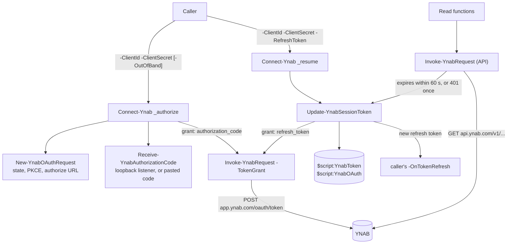

# OAuth: design

Implements [requirements.md](requirements.md). Proposes [ADR-0007](#adr-check).

## Approach / overview

`Connect-Ynab` gains two parameter sets: `_authorize` (browser authorization) and `_resume` (from a stored refresh token). Both end with an OAuth session: the access token in the existing `$script:YnabToken`, so every read function and the cache work unchanged (AC-10), and a new `$script:YnabOAuth` record with the refresh token, expiry, client credentials and the caller's `-OnTokenRefresh` scriptblock. `Invoke-YnabRequest` stays the only HTTP caller: it gains a token-grant parameter set that posts to YNAB's fixed token endpoint, and, for API requests in an OAuth session, refreshes before an expiring request or once after a `401`. A private `Update-YnabSessionToken` performs each refresh and hands the new refresh token to the caller before anything else is sent (AC-13).

## Architecture

### Session state

- `$script:YnabToken` keeps its meaning: the `SecureString` sent as the bearer token. In an OAuth session it holds the current access token.
- `$script:YnabOAuth` is `$null` for a personal-token session, otherwise `@{ ClientId; ClientSecret; RefreshToken; ExpiresAt; OnTokenRefresh }`, with secrets as read-only `SecureString` copies and `ExpiresAt` in UTC from `expires_in`.
- Any successful connect replaces both and clears the cache (AC-7). `Disconnect-Ynab` disposes and clears both (AC-9).

### `Connect-Ynab` parameter sets

| Set | Parameters | Effect |
|---|---|---|
| `_token` (default, unchanged) | `-Token` | Personal access token, as today; also clears any OAuth record |
| `_authorize` | `-ClientId` `[System.String]`, `-ClientSecret` `[SecureString]`, `-RedirectUri` (default `http://localhost:8765/callback`), `-OutOfBand`, `-TimeoutSeconds` (default 300), `-OnTokenRefresh` | Browser authorization, then the code exchange |
| `_resume` | `-ClientId`, `-ClientSecret`, `-RefreshToken` `[SecureString]`, `-OnTokenRefresh` | Redeems the refresh token at once (AC-6) |

- `-OnTokenRefresh` is optional. It is called after the initial exchange and after every refresh, including the one a resume performs. Without it, the session works for this PowerShell process only, and a warning says the refresh token is not being saved.
- The client ID is a plain string: it travels in the authorize URL and is not a secret.

### `_authorize` flow

1. `New-YnabOAuthRequest` (private) creates `state` (16 random bytes) and a PKCE verifier (32 random bytes, 43 characters base64url) with its `S256` challenge, and builds the authorize URL with `scope=read-only` (AC-1).
2. **Loopback** (default): `Receive-YnabAuthorizationCode` (private) checks the redirect host is `localhost`, `127.0.0.1` or `[::1]`, starts an `HttpListener` on that host and port **before** opening the browser, and raises `YnabOAuthListenerFailed` naming the URI and suggesting `-RedirectUri` if it cannot (AC-17). It then opens the browser with `Start-Process`, also writes the URL with `Write-Information` so it can be copied if no browser opens, and waits up to `-TimeoutSeconds` for a request on the redirect path. It answers with a short "you can close this tab" page and stops the listener in `finally` (AC-2). Timeout raises `YnabOAuthTimeout` (AC-3).
3. **Out-of-band** (`-OutOfBand`): the redirect URI becomes `urn:ietf:wg:oauth:2.0:oob`; the URL is opened (or written for copying) and the code is read with `Read-Host -AsSecureString`. There is no redirect to carry `state`, so PKCE is the protection here. How YNAB displays the code is **unverified** and checked live.
4. A returned `error`, or a `state` that differs, raises `YnabOAuthAuthorizationFailed` before any token request (AC-4).
5. The code is exchanged through `Invoke-YnabRequest -TokenGrant` with `client_id`, `client_secret`, `redirect_uri`, `code` and `code_verifier` (AC-5), and the session is set up as for a refresh (below).

### `Invoke-YnabRequest`

- **New `_grant` parameter set:** `-TokenGrant` `[System.Collections.IDictionary]`, form fields for `https://app.ynab.com/oauth/token`, the second fixed host. No bearer token, debug forced off as today, form-encoded body. OAuth errors arrive as `{ "error": "invalid_grant", "error_description": "…" }`, a different shape from API errors, and become `YnabOAuth.<error>` records; the form values never appear in an error record or verbose message (AC-8).
- **API requests in an OAuth session** (no explicit `-Token`):
  - Before sending: if `ExpiresAt` is within 60 seconds, `Update-YnabSessionToken` first (AC-11).
  - On `401`: if not already retried, `Update-YnabSessionToken`, rebuild the request with the new token, and send it once more (AC-12). The existing 401 message is kept for personal-token sessions.
- Personal-token sessions and the `_token` connect path are unchanged.

### `Update-YnabSessionToken` (private)

1. Calls `Invoke-YnabRequest -TokenGrant` with `grant_type=refresh_token`, the client ID and secret, and the stored refresh token. Plain-text copies exist only for the request and are removed in `Clean`.
2. On failure: disposes and clears the session (both variables) and raises `YnabOAuthRefreshFailed`: "The stored refresh token is no longer valid; authorize again with Connect-Ynab -ClientId …" (AC-14).
3. On success: stores the new access and refresh tokens as read-only `SecureString` copies, sets `ExpiresAt`, disposes the old ones, then calls `-OnTokenRefresh` with `[PSCustomObject] @{ RefreshToken = <a separate SecureString copy>; AccessTokenExpiresAt = <UTC DateTime> }` **before returning**, so no further request is sent first (AC-13).
4. If the scriptblock throws, the session keeps the new tokens and a **non-terminating** `YnabOAuthTokenRefreshCallbackFailed` error is written, so the current command still completes. An unattended job should run with `$ErrorActionPreference = 'Stop'` to treat it as fatal; the help says so.

### Rule 1 and design.md

`Invoke-YnabRequest` remains the only `Invoke-RestMethod` caller, now with two fixed hosts and no parameter to change either. `docs/design.md` updates: rule 1 (two hosts), the facts table (redirects, rotation, revocation, `expires_in`, scope enforcement from #26), the OAuth section as built, and the planned-functions table (`Connect-YnabOAuth` and `Update-YnabOAuthToken` removed) (AC-16).

## Affected files / modules

| File | Change | PR |
|---|---|---|
| `docs/specs/oauth/*.md`, `docs/adr/0007-…md` | New | 1 |
| `PS.YNAB.psm1` | Initialize `$script:YnabOAuth` | 1 |
| `Private/Invoke-YnabRequest.ps1` + tests | `_grant` set; OAuth refresh before send and on `401` | 1 |
| `Private/Update-YnabSessionToken.ps1` + tests | New | 1 |
| `Public/Disconnect-Ynab.ps1` + tests | Clear the OAuth record | 1 |
| `Private/New-YnabOAuthRequest.ps1`, `Private/Receive-YnabAuthorizationCode.ps1` + tests | New | 2 |
| `Public/Connect-Ynab.ps1` + tests | `_authorize` and `_resume` sets | 2 |
| `docs/design.md`, `README.md` (Connecting) | OAuth as built; links only, per AGENTS.md | 2 |
| `.github/workflows/ci.yml` | Re-derive `min-tests` | 1, 2 |

PR 1 adds the refresh machinery with no way to start an OAuth session yet; tests create one directly. PR 2 adds the public entry points.

### Tests

- `Invoke-YnabRequest`: token grant posts the form to the fixed URL with no bearer; OAuth error bodies map to `YnabOAuth.<error>`; no form value in any stream; refresh before an expiring request; refresh and single retry on `401`; no second retry; personal-token sessions never refresh.
- `Update-YnabSessionToken`: rotates both tokens and `ExpiresAt`; calls the scriptblock once with a separate copy, before returning; a throwing scriptblock leaves the session working and writes the non-terminating error; failure clears the session and raises `YnabOAuthRefreshFailed`.
- `Receive-YnabAuthorizationCode`: a real listener on a test port receives a request from a thread job (verified on macOS for the spike; CI runs it on Linux); wrong path ignored; `error` and `state` mismatch rejected; timeout; port already in use raises `YnabOAuthListenerFailed` before `Start-Process` is called; non-loopback host rejected. `Start-Process` is always mocked, so no browser opens; nothing leaves the machine.
- `Connect-Ynab`: each set's binding; resume redeems at once; the scriptblock receives the initial token; the cache and any previous session are cleared; out-of-band reads the code from a mocked `Read-Host`.

### Live check (you run it, in PR 2)

You recreate the OAuth app with `http://localhost:8765/callback` and `urn:ietf:wg:oauth:2.0:oob`. A snippet then: authorizes with `-OnTokenRefresh` capturing into a variable; reads; forces expiry and reads again (one refresh, callback count 2, read succeeds); disconnects and resumes from the captured token in the same window; repeats the authorization with `-OutOfBand`. It prints only `True`/`False`, counts and status codes.

## Alternatives considered

| Alternative | Why rejected |
|---|---|
| A separate private function calling `Invoke-RestMethod` for the token endpoint | Breaks design rule 1 and the S3 check; the token call needs the same debug suppression and error handling |
| A `-BaseUri` on `Invoke-YnabRequest` | Would make the host configurable, which the foundation design forbids so tokens cannot be sent elsewhere |
| Replacing `$script:YnabToken` with one session object | Touches every caller and test for no behavioral gain |
| `-OnTokenRefresh` mandatory | Interactive use without persistence is legitimate; a warning covers the forgotten case |
| A terminating error when the scriptblock throws | The read that triggered the refresh would fail even though the session is healthy; the job opts in to fatal with `$ErrorActionPreference` |
| Refresh only on `401` | Every first request after expiry would fail once and retry; checking `ExpiresAt` avoids that, and the `401` path still covers clock skew and revocation |
| Validating the authorization with `GET /user` | The successful exchange already proves the code, client and secret |

## Risks / tradeoffs

- **A refresh followed by a failure to persist** leaves the caller's stored token revoked. Mitigated by calling the scriptblock before any other request and surfacing its failure; not removable, since the module stores nothing (ADR-0003).
- **Two processes sharing an authorization** revoke each other's tokens; the help and design say each process needs its own authorization (out of scope to coordinate).
- **The listener test needs a free port on the CI runner.** Tests pick the port at run time; a clash fails loudly.
- **Out-of-band display is unverified**; the live check covers it before merge.
- **Clock skew** beyond 60 seconds would make the expiry check late; the `401` retry covers it.
- **Security:** the listener binds loopback only and accepts one request; `state` and PKCE guard the code; the client secret and tokens stay `SecureString` except inside a single request, and never reach an output stream.

## ADR check

**ADR-0007: OAuth sessions with rotating refresh tokens** (proposed with PR 1). Cross-cutting and durable, because the alerter and any future caller build on it:

- the token rotation and revocation behavior verified in #26
- the `-OnTokenRefresh` hand-back contract and its timing (before any further request)
- one authorization per process
- `Invoke-YnabRequest` owning the token endpoint as a second fixed host

It refines ADR-0003's "refreshed tokens will be handed back to the caller" without contradicting it, so it does not amend ADR-0003.
